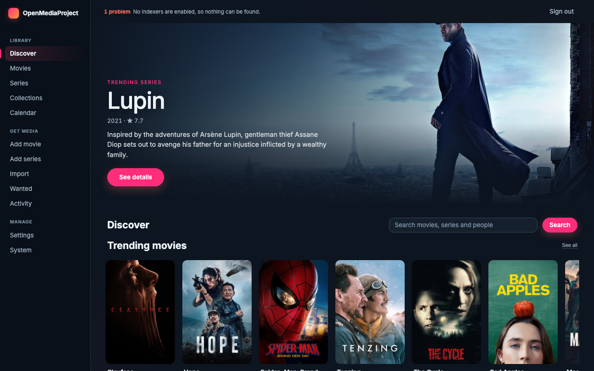
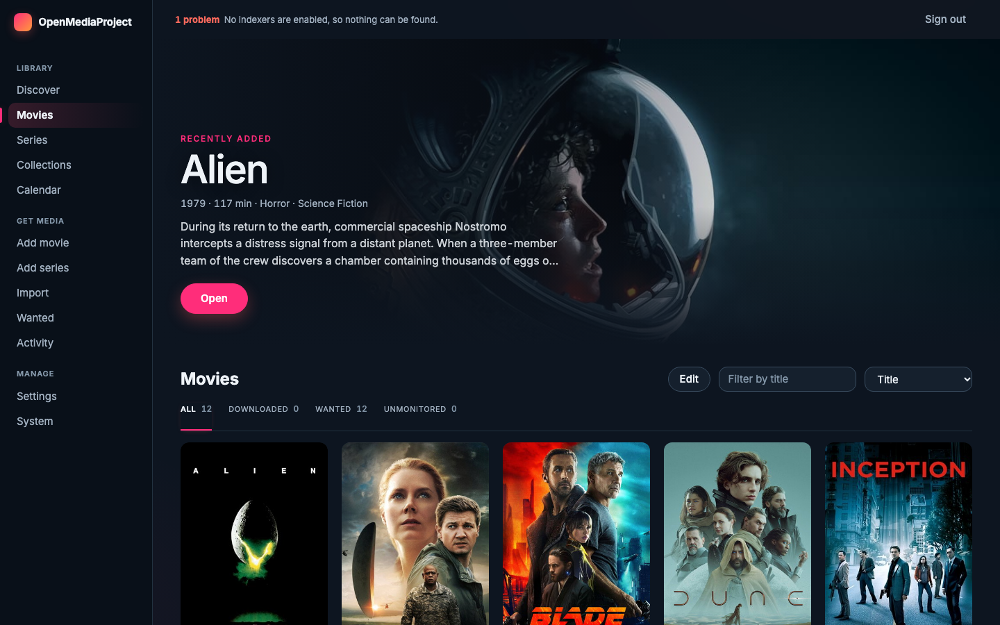
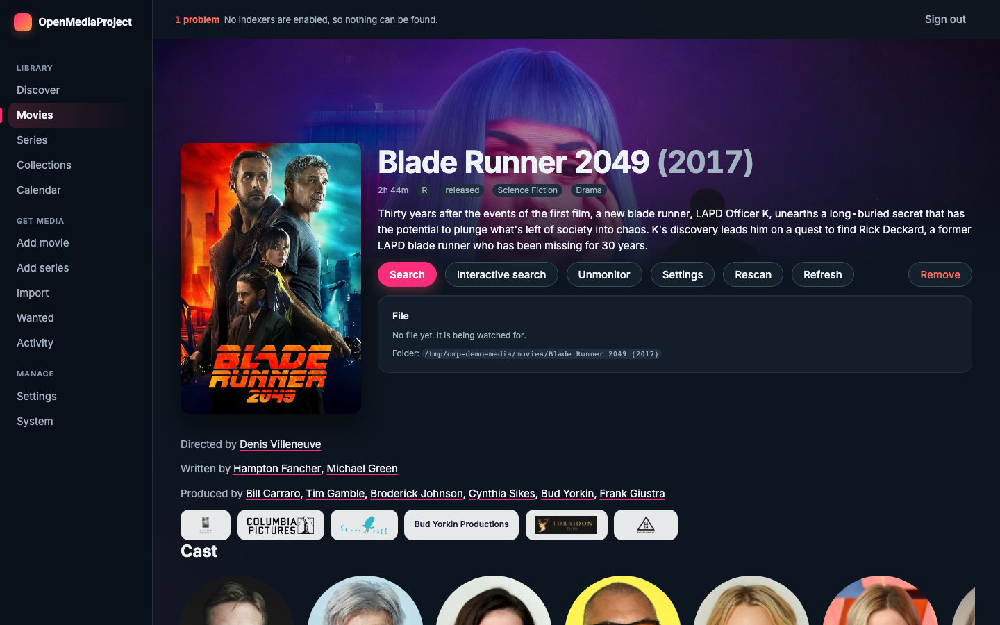
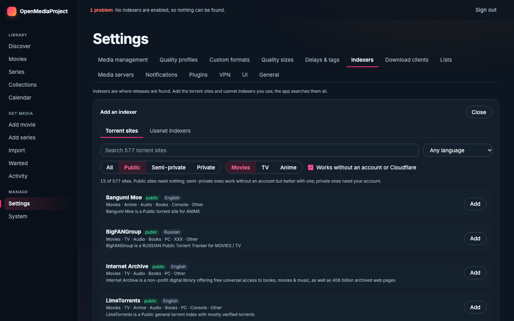
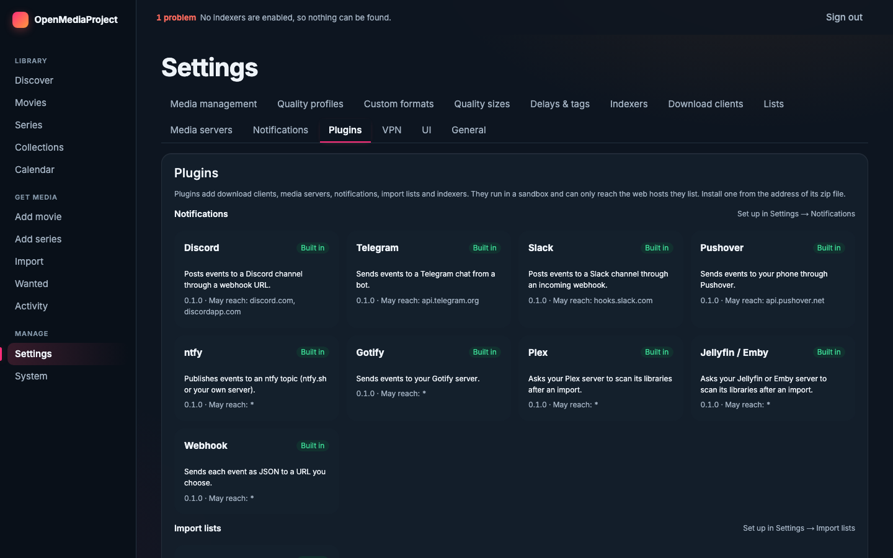
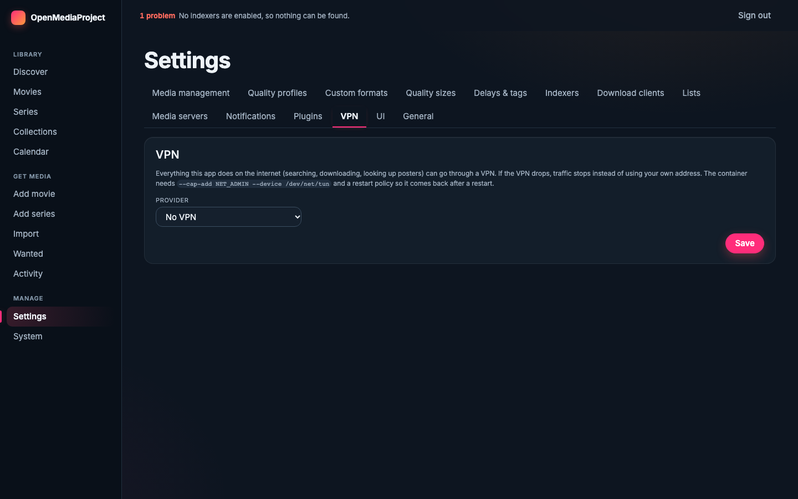

<p align="center">
  <a href="https://github.com/jaydenrasmussen/OpenMediaProject/releases/latest" title="Download the latest release">
    
  </a>
</p>

<p align="center">
  Radarr and Sonarr in one program.<br>
  Movies and series, 577 torrent sites and the usenet indexers, built-in usenet and BitTorrent downloaders, a VPN, and plugins for the rest. One container, written in Rust.
</p>

<p align="center">
  <a href="https://github.com/jaydenrasmussen/OpenMediaProject/releases/latest"></a>
  <a href="https://github.com/jaydenrasmussen/OpenMediaProject/actions/workflows/pr.yml"></a>
  <a href="https://github.com/jaydenrasmussen/OpenMediaProject/pkgs/container/openmediaproject"></a>
  <a href="LICENSE"></a>
</p>

<p align="center">
  <b><a href="https://github.com/jaydenrasmussen/OpenMediaProject/releases/latest">Download</a></b> ·
  <b><a href="#install">Install</a></b> ·
  <b><a href="#first-steps">First steps</a></b> ·
  <b><a href="#documentation">Docs</a></b> ·
  <b><a href="https://github.com/jaydenrasmussen/OpenMediaProject/releases">Changelog</a></b>
</p>

## Features

- **Movies and series in one app:** quality profiles, custom formats, delay and release profiles, tags, a calendar, Wanted lists, scene numbering, renaming and manual import.
- **Discover:** a TMDB-powered home with a trending banner and shelves. Open any title for its cast, directors, producers and studios, then follow them to a person's or company's other work. Search pages through every result.
- **Built-in downloaders:** a usenet client (NNTP, yEnc, par2, unrar and 7z) and a BitTorrent client. Both are on from the first start; nothing else to install. SABnzbd, NZBGet, qBittorrent and Transmission work too, as plugins.
- **Indexers:** 577 torrent sites from [Prowlarr's definitions](https://github.com/Prowlarr/Indexers) and the Newznab usenet indexers, each in a list you can search and filter. Sites behind Cloudflare work through [FlareSolverr](https://github.com/FlareSolverr/FlareSolverr).
- **VPN built in:** [Gluetun](https://github.com/qdm12/gluetun) is in the image (Mullvad, NordVPN, Proton and about 25 more). Pick a provider in Settings and every connection the app makes goes through the tunnel; if it drops, traffic stops.
- **Plugins:** WebAssembly plugins add indexers, notifications, import lists and download clients. They run sandboxed and can reach only the hosts they declare. Install one from a URL.
- **Plex and Jellyfin:** connect a server and every title shows whether it is already there, and Wanted leaves out what a server already holds. Read-only.
- **Notifications:** email is built in. Plugins cover Discord, Slack, Telegram, ntfy, Gotify, Pushover, Plex, Jellyfin and Emby, and webhooks.
- **Import lists:** keep a movie library filled from a list. Lists are plugins (a custom list that reads a URL is included) and can name movies or series.
- **Live:** the UI updates over a WebSocket as downloads move and tasks finish. There is a documented API at `/api/v1/openapi.json`.
- **Built to run unattended:** one binary with the UI inside, SQLite, backups, a health page that says what is wrong in words, and sign-in with rate limiting.

<details open>
<summary><h2>Screenshots</h2></summary>

<p align="center">
  
  &nbsp;
  
</p>
<p align="center">
  
  &nbsp;
  
</p>
<p align="center">
  
  &nbsp;
  
</p>
</details>

## Install

**Requirements:** Docker (or any container runtime), and a folder for your media and one for downloads.

1. **Start the container.** Change the three paths on the left of each `-v`:

   ```
   docker run -d --name omp --restart unless-stopped -p 8080:8080 \
     -v omp-config:/config \
     -v /path/to/downloads:/downloads \
     -v /path/to/media:/media \
     ghcr.io/jaydenrasmussen/openmediaproject:stable
   ```

   Or with Compose:

   ```yaml
   services:
     omp:
       image: ghcr.io/jaydenrasmussen/openmediaproject:stable
       container_name: omp
       restart: unless-stopped
       ports: ["8080:8080"]
       volumes:
         - omp-config:/config
         - /path/to/downloads:/downloads
         - /path/to/media:/media
   volumes:
     omp-config:
   ```

2. **Open** http://localhost:8080 and create the first account.
3. Follow [First steps](#first-steps).

Use the same paths for your media inside the container as your old Radarr and Sonarr did, so folders line up when you import.

> [!TIP]
> `:stable` follows the newest full release. Pin a version such as `:1.2.0` to update only when you choose, or use `:latest` to track the main branch.

**Without Docker:** download `openmediaproject-<version>-linux-x86_64.tar.gz` (or `aarch64`) from the [latest release](https://github.com/jaydenrasmussen/OpenMediaProject/releases/latest), check it against `SHA256SUMS`, unpack it and run `./omp-server`. It needs `par2`, `7zz` (7-Zip) and `ffprobe` on the path; the container has them. To build it yourself, see [Build](#build).

## First steps

1. **Root folders:** Settings → Media management → add the folders your movies and series live in.
2. **Indexers:** Settings → Indexers → *Add indexer*. Search the 577 torrent sites or the usenet indexers, add the ones you use, and press **Test**. Public sites need nothing; private ones ask for your account.
3. **Download clients:** the built-in torrent client works at once. For usenet, open Settings → Download clients → *Built-in usenet* → Edit and add your news provider (host, port, login, connections).
4. **Add something:** **Discover** shows what is trending, or use **Add movie** and **Add series** to search. Pick a quality profile and a root folder and the app starts looking for it.
5. **Already have a library?** Use **Import** to adopt the folders you have. See [Moving from Radarr or Sonarr](docs/migrating.md).

A **VPN** is one tab away: Settings → VPN. See [docs/vpn.md](docs/vpn.md).

## Configuration

Everything you need is in Settings. These variables are for the container's environment:

| Variable | Meaning |
| --- | --- |
| `OMP_DATA_DIR` | Databases and settings (`/config` in the image) |
| `OMP_DOWNLOADS_DIR` | Where downloads land (`/downloads` in the image) |
| `OMP_ADDR` | Listen address, default `0.0.0.0:8080` |
| `OMP_URL_BASE` | Reverse-proxy prefix such as `/media` |
| `OMP_PUBLIC_URL` | The address other machines reach this app at (needed when an external torrent client fetches `.torrent` files through it) |
| `TMDB_READ_TOKEN` | Your own TMDB "API Read Access Token". Optional: a shared read-only key is built in |
| `OMP_RADARR_METADATA=off` | Use TMDB alone for movies |
| `OMP_SKYHOOK=off` | Use TMDB alone for series |
| `OMP_PLUGINS_DIR` | Extra plugin folder (the last folder is where installs go) |
| `VPN_SERVICE_PROVIDER` and other Gluetun variables | Turn the VPN on from the environment; see [docs/vpn.md](docs/vpn.md) |

Port, URL base, HTTPS, proxy, log and TMDB-token settings can also be set in the UI; they apply after a restart, and the environment wins.

For the VPN the container needs `--cap-add NET_ADMIN --device /dev/net/tun`.

## Plugins

Plugins are WebAssembly components. The ones that ship with the image: Discord, Slack, Telegram, ntfy, Gotify, Pushover, Plex, Jellyfin/Emby, webhooks, a custom list, SABnzbd, NZBGet, qBittorrent, Transmission, Plex and Jellyfin libraries, and the Prowlarr indexers. Settings → Plugins lists them, and installs more from a URL or a file after showing you exactly which hosts the plugin may reach. To write your own, see [docs/plugins.md](docs/plugins.md).

## Updating

```
docker pull ghcr.io/jaydenrasmussen/openmediaproject:stable
docker rm -f omp && docker run …   # the same command as before; /config keeps your settings
```

With Compose: `docker compose pull && docker compose up -d`. System has backups; take one before a major version.

## Build

```
cd ui && npm ci && npm run build   # writes ui/out
cd .. && cargo build --release -p omp-server
```

Release builds embed `ui/out`; debug builds read it from disk. Plugins build with `cargo build --release --target wasm32-wasip2` inside `plugins/<name>`. The `Dockerfile` builds everything, including the tools the image bundles.

```
cargo fmt --all --check && cargo clippy --workspace --all-targets -- -D warnings && cargo test --workspace
```

Browser tests are in [e2e/](e2e/README.md).

### Making a release

Maintainers: Actions → **Release** → *Run workflow*, with a version such as `1.2.0`. It checks that CI passed on the commit, pushes the container image (`1.2.0`, `1.2`, `1`, `stable`), builds the Linux downloads, tags the commit and publishes the release with generated notes.

## Help

- **Question or idea?** Please [open an issue](https://github.com/jaydenrasmussen/OpenMediaProject/issues).
- **Bug?** Please [open an issue](https://github.com/jaydenrasmussen/OpenMediaProject/issues) with the version (System → About) and what the event log says (System → Logs).
- **Security problem?** Read [docs/security.md](docs/security.md), then use GitHub's "Report a vulnerability" on the Security tab rather than a public issue.

## Documentation

- [Moving from Radarr or Sonarr](docs/migrating.md)
- [Indexers and TMDB](docs/indexers.md) · [Built-in VPN](docs/vpn.md) · [Plex and Jellyfin](docs/media-servers.md)
- [Plugins](docs/plugins.md) · [Security review](docs/security.md)
- [What was checked, and by which test](docs/audit.md)

## License

[GPL-3.0-only](LICENSE). The indexer definitions in `crates/omp-cardigann/definitions` come from [Prowlarr/Indexers](https://github.com/Prowlarr/Indexers) and are GPL-3.0 as well. The image also contains Gluetun (MIT), 7-Zip, par2cmdline-turbo and a static ffprobe build, each under its own licence.

## Credits

Radarr, Sonarr and Prowlarr set the ground rules this project follows, and their metadata servers and indexer definitions do much of the work. Torrents run on [librqbit](https://github.com/ikatson/rqbit). The VPN is [Gluetun](https://github.com/qdm12/gluetun).

This product uses the TMDB API but is not endorsed or certified by [TMDB](https://www.themoviedb.org). Posters and banners are TMDB's.

OpenMediaProject is an independent project and is not affiliated with Radarr, Sonarr, Prowlarr or TMDB.
